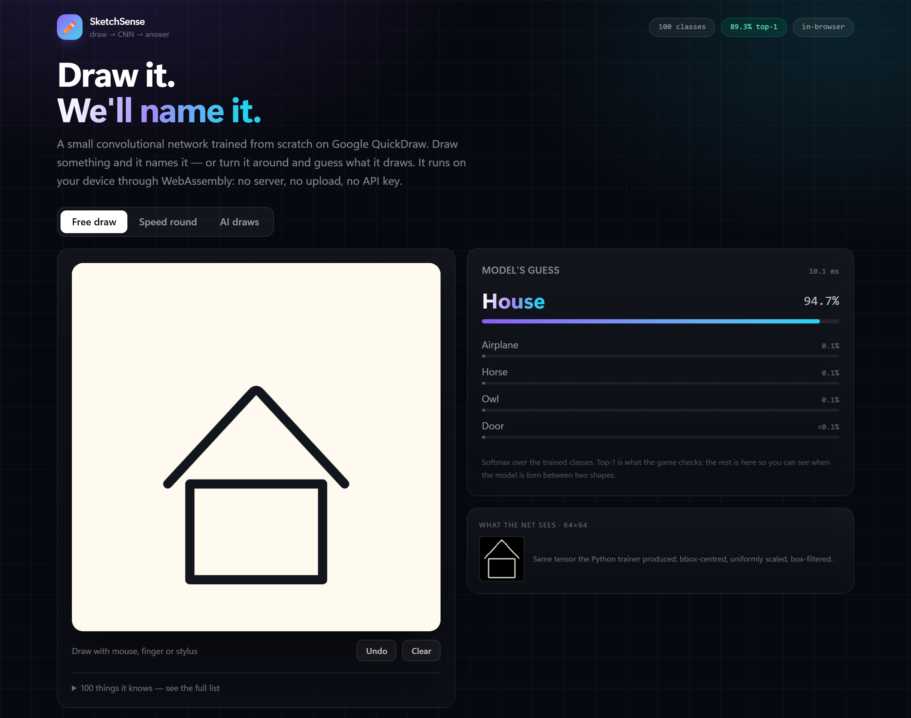

# SketchSense

**Draw a doodle, a convolutional network names it — in your browser, with no server.**

[](https://sketchsense.corescode.workers.dev)
[](https://github.com/CoresCode/SketchSense/actions/workflows/ci.yml)
[](LICENSE)
[](#how-it-works)

### ▶ **[Try it live — sketchsense.corescode.workers.dev](https://sketchsense.corescode.workers.dev)**

SketchSense is a 100-class image classifier trained from scratch on Google's
[QuickDraw](https://github.com/googlecreativelab/quickdraw-dataset) dataset and exported to
ONNX so it runs locally in the page via ONNX Runtime Web (WASM). Nothing is uploaded, there
is no API key, and hosting is a static folder.

<!-- stats:start -->
<!-- regenerated by `python ml/report.py --ckpt <best.pt>`; do not edit by hand -->
| | |
|---|---|
| Classes | **100** QuickDraw categories |
| Model | 4-stage residual CNN, **1.59 M parameters** |
| Held-out top-1 | **90.5%** |
| Held-out top-5 | **97.4%** |
| Inference | **~4 ms** per guess (WASM, single thread, this laptop) |
| Model file | **1.7 MB** int8 ONNX |
| Backend | none |
<!-- stats:end -->



---

## Three ways to play

| Mode | What it does |
|---|---|
| **Free draw** | Draw anything; the top-5 updates live as you draw, with confidence bars and a measured inference time. |
| **Speed round** | Fixed time per doodle, points for speed, and the guess only counts above 35% confidence *and* after the pen has been still for 1.2 s — a half-finished doodle gets a chance to become a doodle. |
| **AI draws** | The model plays the other side: real QuickDraw sketches are replayed stroke by stroke and you type what you think it is. |

**AI draws** deserves a note on honesty: it is not a generative model. The sketches are real
human drawings from the held-out data, animated in stroke order. What *is* model-driven is the
difficulty — every candidate is scored by the classifier against its own label, so **easy** uses
the sketches it is most certain about, and **hard** samples the ambiguous 20th–35th percentile
and adds a wobble so the line looks like a hurried human hand.

Guessing is free text with autocomplete and one-typo tolerance, not multiple choice, so it does
not turn into a 4-way coin flip.

The speed round's prompts come from `web/public/model/game-classes.json`, which `ml/report.py`
writes from held-out per-class accuracy — currently 95 of the 100 classes. Prompting with the
classes the model reliably reads (and dropping the ones nobody can doodle in twenty seconds)
keeps the round about drawing rather than about the dataset's blind spots.

---

## Why this exists

I wanted a portfolio project where the model is *actually mine* and the thing is *actually
fun to use*. Doodle classification is a good fit: the data is free and enormous, the task is
visually obvious (so a demo needs no explanation), and the compute is small enough that the
whole pipeline — data, training, export, deployment — fits in one repo and runs on a laptop.

## How it works

```
QuickDraw NDJSON (raw pen strokes)
        │  ml/download.py    stream + early-stop at 12k sketches/class
        ▼
ml/data/raw/*.ndjson
        │  ml/prepare.py     rasterise 64x64, bbox-normalised
        ▼
ml/data/processed/*.npy     uint8 (N, 64, 64)
        │  ml/train.py       AMP, OneCycle, GPU affine augmentation
        ▼
ml/artifacts/best.pt
        │  ml/export.py      ONNX opset 17 + parity gate vs PyTorch
        ▼
web/public/model/model.onnx ──► onnxruntime-web (WASM) ──► canvas UI
```

The browser replicates the Python preprocessing exactly (`web/src/lib/raster.ts` mirrors
`ml/raster.py`), because a silent preprocessing mismatch is the most common way a model that
scores well offline looks broken in production.

## The parts worth reading

**1. Preprocessing is a contract, and it is tested.**
Both rasterisers: drop strokes shorter than 2 points → take the bounding box → centre it →
scale the longest side to `canvas - 2*pad` → draw at 256×256 → box-filter 4×4 down to 64×64.
`ml/fixtures.py` freezes 24 real sketches with the exact tensor Python produced, and
`/raster-check.html` asserts the browser produces the same shape.

**2. The export cannot silently ship a broken graph.**
`ml/export.py` runs 512 validation images through both PyTorch and ONNX Runtime and exits
non-zero unless top-1 agreement is 100% and max logit drift is < 0.01. BatchNorm folding and
resize alignments are exactly the kind of thing that changes behaviour during export.

**3. Inference runs where the user is.**
Single-threaded WASM was chosen over WebGPU on purpose: one ~15 MB artifact instead of a
jsep build, no COOP/COEP headers, and a 1.6 M-parameter net at 64×64 is fast enough that the
GPU would be wasted. The whole site is static files.

**4. It is measured, not vibed.**
Top-1 / top-5 on a stratified held-out split, a confusion-matrix export, and per-class
accuracy in `docs/metrics.md`. The failure cases are the interesting part.

**5. Speed came from looking, not guessing.**
The first version trained at 990 images/s. Giving the stem convolution stride 2 — the input
stays 64×64, the stem just halves resolution once, up front — took it to **4,033 images/s
(4.07×)** for roughly a point of accuracy at epoch 1. Batch size was swept as well (128, 256,
512, 1024); 256 won.

Two smaller wins followed, both from profiling rather than intuition: the running loss and
accuracy now accumulate on the GPU and are read once per 100 steps instead of every step
(a per-step read forces a device sync), and batches cross PCIe as `uint8` and are converted on
the card — 4× less traffic. Host-side step prep went from 6.0 ms to 0.9 ms in isolation.
The scripts that produced these numbers are in `ml/sweep_arch.py`, `ml/tune_batch.py`,
`ml/profile_input.py` and `ml/profile_step.py`.

## Where it stopped, and why

A 40-epoch from-scratch run (`quickdraw-100-long40`) landed at **90.61%** top-1 against the
shipped warm-restart model's **90.57%** — 0.04 points, i.e. inside the noise of a 72k-sample
split. It also put *fewer* classes above the 80% floor the speed round draws its prompts from
(92 vs 95), so the older checkpoint is the one that ships. Past ~90% the remaining error is
concentrated in genuinely ambiguous classes — dog/horse, violin/guitar, cup/coffee cup — and
more epochs only trade one for another. The 14 MB wasm plus a 1.6 MB model is the size that
buys ~90%, and the write-up is more useful than another 0.1.

## Making it load on a bad connection

The model was fine and the page still took two minutes to become usable on a ~1 Mbit/s link.
Measuring first, instead of guessing: the browser was pulling **9.8 MB** on the wire — 3.4 MB
of brotli-compressed ONNX Runtime wasm plus a 6.4 MB fp32 graph — and the wasm request did not
even *start* until the model had finished, because ONNX Runtime only asks for it inside
`InferenceSession.create()`.

The obvious fix is wrong. Prefetching the wasm so both downloads overlap changes nothing on a
bandwidth-limited link: the pipe is the constraint, and 9.8 MB takes the same time whether it
arrives in one queue or two. Worse, a prefetch that misses the HTTP cache downloads the wasm
twice. I measured it, confirmed the non-result, and dropped it.

What actually worked was shipping fewer bytes. `ml/quantize.py` tries both quantisations and
refuses to write an output that loses more than 0.3 points:

| | top-1 (72,000 held-out) | size |
|---|---|---|
| fp32, as trained | 90.57% | 6.4 MB |
| dynamic int8 (weights only) | **89.50%** — rejected | 1.6 MB |
| static int8 (QDQ, calibrated) | **90.52%** — shipped | 1.6 MB |

Dynamic quantisation re-derives activation scales on every call and cost 1.1 points. Static
QDQ with activation ranges calibrated on 1,024 *training* sketches cost 0.05 — inside the
noise — and inference got faster rather than slower (about 6 ms → 3.5 ms), because int8 conv
kernels beat fp32 in the WASM backend. Total download fell from 9.8 MB to 5.0 MB, roughly
halving the wait on a slow link.

`report.py` gained `--onnx`, so every number in this README, in `docs/metrics.md`, in
`game-classes.json` and in the badge on the page is now measured on the graph the browser
actually downloads, not on its fp32 ancestor. The prompt pool held at 95 of 100 classes.

## Run it locally

The shipped model is committed, so the front end stands alone — 30 seconds, no training, no
Python:

```bash
cd web
npm install
npm run dev      # http://127.0.0.1:5180
```

Everything below is how that model was produced, from raw QuickDraw strokes to the file the
browser downloads. It needs Python 3.11+, a CUDA GPU (or patience), and ~5 GB of disk for the
dataset.

### Reproduce the model

```powershell
# model (already committed, but this is how it is produced)
cd ml
..\.venv\Scripts\python.exe download.py --max-sketches 12000 --workers 4
..\.venv\Scripts\python.exe prepare.py --limit 12000

# 20 epochs from scratch, then two low-LR warm restarts for the last few points
..\.venv\Scripts\python.exe train.py --epochs 20 --batch 256 --lr 0.002 --stem-stride 2 --out artifacts\run2
..\.venv\Scripts\python.exe train.py --epochs 6 --batch 256 --lr 0.0004 --stem-stride 2 `
    --init-from artifacts\run2\best.pt --out artifacts\run2b
..\.venv\Scripts\python.exe train.py --epochs 12 --batch 256 --lr 0.0004 --stem-stride 2 `
    --init-from artifacts\run2b\best.pt --out artifacts\run2c

..\.venv\Scripts\python.exe export.py --ckpt artifacts\run2c\best.pt   # ONNX + parity gate
..\.venv\Scripts\python.exe quantize.py --mode static `               # 6.4 MB -> 1.6 MB int8
    --onnx artifacts\sketchnet.onnx --out web\public\model\model.onnx
..\.venv\Scripts\python.exe export_samples.py --ckpt artifacts\run2c\best.pt  # AI-draw sketches
..\.venv\Scripts\python.exe report.py --ckpt artifacts\run2c\best.pt `
    --onnx ..\web\public\model\model.onnx                              # metrics of the shipped graph
..\.venv\Scripts\python.exe fixtures.py

# front end
cd ..\web
npm install
npm run dev      # http://127.0.0.1:5180
npm run build    # static output in dist/
```

The repo ships `web/public/model/model.onnx`, so steps 1–7 are only needed if you change the
model. Deployment is a static folder — see [`docs/DEPLOY.md`](docs/DEPLOY.md) for the
from-zero walkthrough (Cloudflare Workers, but any static host works).

## Test it like a user, not like a unit

`tools/qa.mjs` drives headless Chrome through all three modes with real mouse and keyboard
input, then fails on console errors, failed requests, a wrong top-1, slow inference, or a page
that scrolls sideways at 390 px. `tools/test_speed_round.mjs` is the focused regression test
for the scoring rule above: it draws a smiley face in the order a person would and asserts
nothing scores until the mouth is on and the pen has been down for the settle window.

```powershell
npm run typecheck                       # in web/
node tools/qa.mjs --url http://127.0.0.1:5180
node tools/test_speed_round.mjs --url http://127.0.0.1:5180
```

## Repo layout

```
ml/      data pipeline, model, training, export, quantisation, parity fixtures, reporting
web/     Vite + React + TS + Tailwind UI, ONNX Runtime Web inference
docs/    metrics, confusion matrix, screenshots, deployment notes
tools/   headless-Chrome tests and the screenshot pipeline (see below)
```

## Limitations

* 64×64 greyscale is the ceiling: fine detail (a whisker vs a spider leg) is lost, which shows
  up in the confusion pairs.
* QuickDraw is line art drawn by thousands of people; photos of real objects are out of
  distribution and the model is not claimed to handle them.
* No temporal/state modelling of stroke order — two visually identical doodles drawn in a
  different order look the same to the model. That is a deliberate scope cut, not an oversight.
* 100 of QuickDraw's 345 categories are trained. Adding more is a data change, not a code
  change: edit `ml/classes.txt`, rerun the pipeline, retrain, re-export. The browser reads
  whatever `labels.json` and `model.onnx` it is given.

## Credits

Dataset: [Google QuickDraw](https://github.com/googlecreativelab/quickdraw-dataset), released
under CC BY 4.0. Model, pipeline and UI by [Anurag Yadav](https://corescode.com).

## Licence

MIT — see [LICENSE](LICENSE). The dataset keeps its own CC BY 4.0 terms; the sketches replayed
in AI-draw mode are QuickDraw drawings, not generated images.
