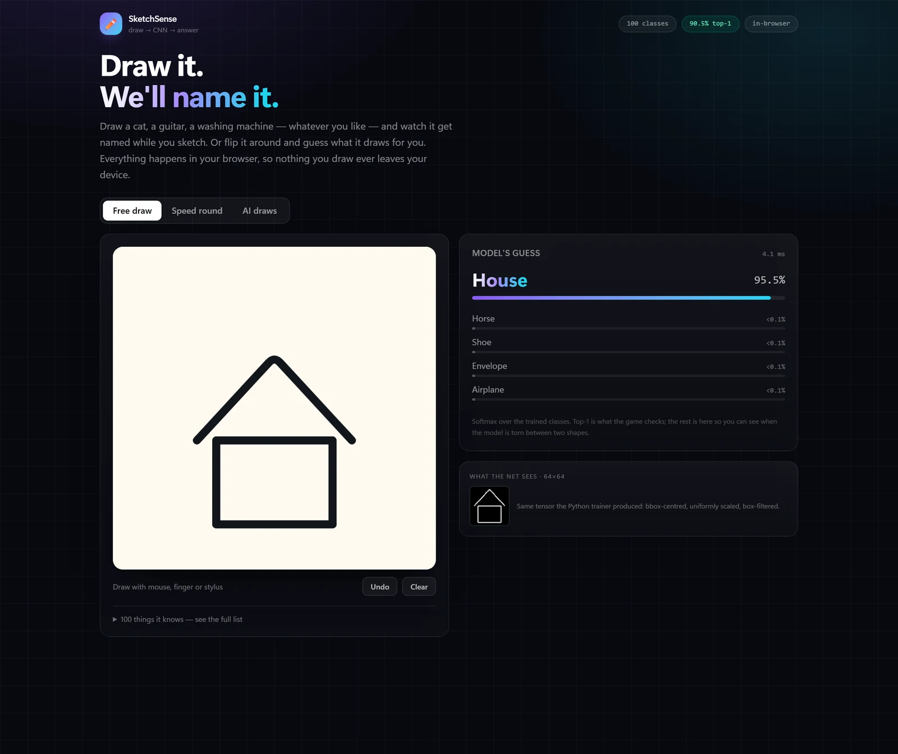
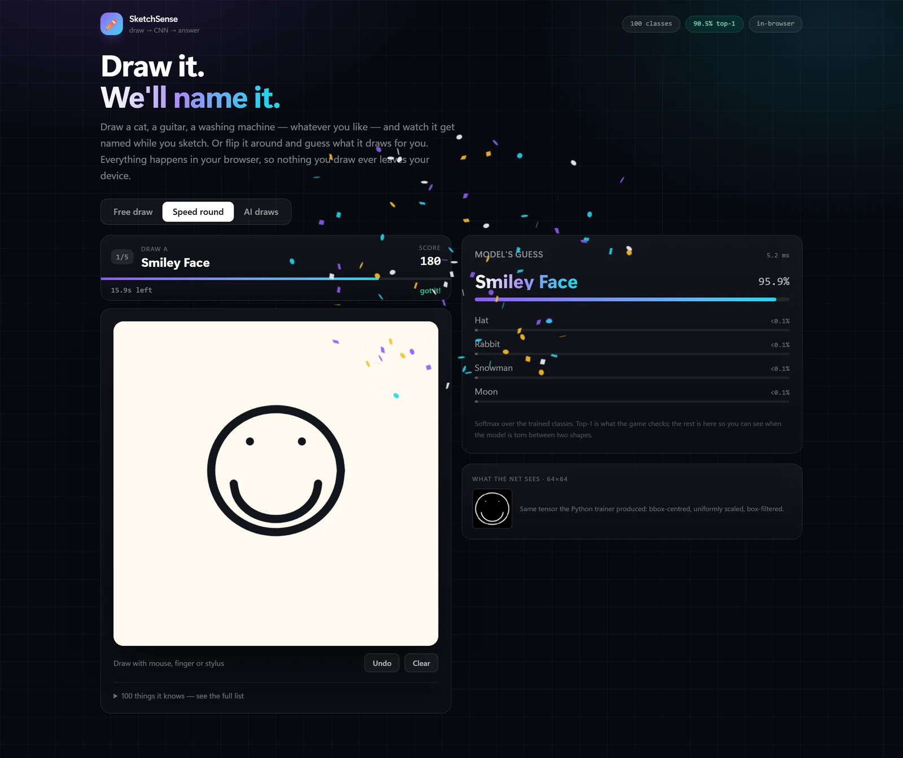
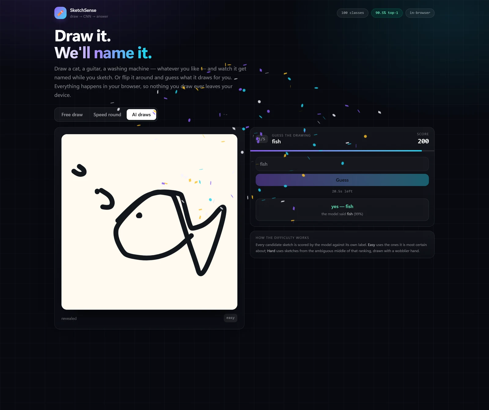

# SketchSense

**Draw a doodle, a convolutional network names it — in your browser, with no server.**

[](https://sketchsense.corescode.workers.dev)
[](https://github.com/CoresCode/SketchSense/actions/workflows/ci.yml)
[](LICENSE)
[](#91-why-wasm-and-not-webgpu)

### ▶ **[Try it live — sketchsense.corescode.workers.dev](https://sketchsense.corescode.workers.dev)**

SketchSense is a 100-class image classifier trained from scratch on Google's
[QuickDraw](https://github.com/googlecreativelab/quickdraw-dataset) dataset and exported to
ONNX so it runs locally in the page via ONNX Runtime Web (WASM). Nothing is uploaded, there
is no API key, and hosting is a static folder.

<!-- stats:start -->
<!-- regenerated by `python ml/report.py --ckpt <best.pt>`; do not edit by hand -->
| | |
|---|---|
| Classes | **100** QuickDraw categories |
| Model | 4-stage residual CNN, **1.59 M parameters** |
| Held-out top-1 | **90.5%** |
| Held-out top-5 | **97.4%** |
| Inference | **~4 ms** per guess (WASM, single thread, this laptop) |
| Model file | **1.7 MB** int8 ONNX |
| Backend | none |
<!-- stats:end -->



*A real frame from the deployed app: a house drawn with the mouse, the top-5 updating live,
and 3.7 ms next to the guess. The screenshots in this README are captures of the running
site, not mockups — see [`docs/portfolio/`](docs/portfolio/) for how they are made.*

---

## Contents

- [0. The one-paragraph version](#0-the-one-paragraph-version)
- [1. What this project had to satisfy](#1-what-this-project-had-to-satisfy)
- [2. The dataset](#2-the-dataset)
- [3. From pen strokes to a 64x64 tensor](#3-from-pen-strokes-to-a-64x64-tensor)
- [4. The network](#4-the-network)
- [5. Training](#5-training)
- [6. Evaluation](#6-evaluation)
- [7. Export: getting out of PyTorch](#7-export-getting-out-of-pytorch)
- [8. Quantisation: 6.4 MB to 1.7 MB](#8-quantisation-64-mb-to-17-mb)
- [9. Running in a browser tab](#9-running-in-a-browser-tab)
- [10. The interface](#10-the-interface)
- [11. Game one: the speed round](#11-game-one-the-speed-round)
- [12. Game two: AI draws](#12-game-two-ai-draws)
- [13. Testing](#13-testing)
- [14. Deployment](#14-deployment)
- [15. Reproducing it](#15-reproducing-it)
- [16. What went wrong](#16-what-went-wrong)
- [17. Limits and what comes next](#17-limits-and-what-comes-next)
- [18. Glossary](#18-glossary)
- [File map](#file-map)
- [Credits and licence](#credits-and-licence)

If you read this top to bottom you will know where every byte came from, why each choice was
made, and which of those choices were mistakes first.

---

## 0. The one-paragraph version

Google publishes 50 million human doodles, each as the actual pen strokes someone drew. We
download 100 categories (12,000 drawings each), rasterise every drawing to a normalised 64×64
greyscale image, and train a small residual convolutional network to map that image to one of
100 labels. The trained network is exported to ONNX, compressed to int8, and served as a
static file. When you draw in the page, a second implementation of the same rasteriser turns
your strokes into the same 64×64 grid, ONNX Runtime Web runs the network on your CPU inside
the tab, and the top five probabilities are drawn as bars. There is no server, no API, no
account, and no data leaving your machine.

---

## 1. What this project had to satisfy

The brief was self-imposed, but every constraint in it shaped the architecture:

| Constraint | Consequence |
|---|---|
| **Zero budget, and a link a recruiter can click** | Static hosting on a free tier. That is only possible if inference happens on the visitor's machine. |
| **No backend** | The model has to be a file, not a service. Hence ONNX, not a Python API. |
| **Must work on a phone, on a normal connection** | Total download matters more than raw accuracy. Hence a 1.59 M-parameter network and int8 weights. |
| **Must feel instant while drawing** | Inference has to be a few milliseconds, which rules out a 25 MB backbone on a CPU. |
| **Numbers have to be honest** | Every published accuracy is measured on the exact graph the browser downloads, on sketches the model never trained on. |
| **The model has to be mine** | No pretrained weights. Trained from random initialisation on QuickDraw. |

That is the whole design space. A bigger model would score better and load worse; a hosted
API would train faster and cost money; WebGPU would be quicker and exclude devices. Everything
below is the consequence of picking the browser as the runtime.

### The shape of the system

```
raw pen strokes
      │  ml/download.py       stream 100 QuickDraw classes, stop at 12k each
      ▼
ml/data/raw/*.ndjson
      │  ml/prepare.py        rasterise to 64x64 uint8, parallel per class
      ▼
ml/data/processed/*.npy      1,200,000 images + manifest.json
      │  ml/train.py          residual CNN, AMP, GPU augmentation
      ▼
ml/artifacts/run2c/best.pt
      │  ml/export.py         ONNX opset 17 + numerical parity gate
      ▼
sketchnet.onnx (6.4 MB)
      │  ml/quantize.py       static int8, accuracy gate
      ▼
web/public/model/model.onnx  (1.66 MB)  ──►  ONNX Runtime Web (WASM)  ──►  React UI
```

Everything to the left of the last arrow runs once, on a laptop. Everything to the right of
it runs in the visitor's tab.

---

## 2. The dataset

### 2.1 Why QuickDraw

[QuickDraw](https://github.com/googlecreativelab/quickdraw-dataset) is a dataset of doodles
collected by Google's "Quick, Draw!" game: 345 named categories, over 50 million drawings,
released under CC BY 4.0. Three properties made it the right choice:

1. **The task is visually obvious.** A demo of "draw a cat, it says cat" needs no explanation.
   That is worth a lot for a portfolio project.
2. **The data is free and enormous.** 12,000 drawings per class is enough to train a small
   network properly without any labelling work.
3. **The raw format is strokes, not pixels.** That means we control the rasterisation, we can
   rasterise at 64×64 instead of being stuck at the 28×28 mirror, and the same download can
   later be replayed stroke-by-stroke in the "AI draws" game.

The catch is that QuickDraw is line art drawn by thousands of different people, with wildly
different proportions, stroke orders and levels of care. That variance is the point: the
model has to learn the *shape of a cat*, not one person's cat.

### 2.2 Two ways to download it, and why the NDJSON one won

Google publishes the dataset in several forms. The two that matter here:

| Format | What it is | Size | Why it was or wasn't used |
|---|---|---|---|
| `numpy_bitmap` | Pre-rasterised 28×28 greyscale bitmaps, one `.npy` per class | ~92 MB per class | Instant to load, but locked at 28×28 and you inherit Google's centring and stroke width. Also much larger to download. |
| `simplified` NDJSON | One JSON object per line: the simplified pen strokes, coordinates 0–255 | ~10 MB for the first 12k drawings of a class | **Chosen.** Line-delimited, so the download can stop early; raw strokes, so we rasterise ourselves at 64×64 with our own normalisation; the same file feeds the AI-draw game. |

The early stop is the important part. NDJSON is one drawing per line, so reading the first
12,000 lines and closing the connection is legal and cheap. We do not need the whole class —
we need 12,000 examples of it — and a class file can hold far more than that. The script
streams, counts lines, and aborts the response once it has enough.

This also makes the download **resumable**. Each class lands in `ml/data/raw/<slug>.ndjson`.
On a re-run, a class whose file is already complete is skipped; `--retry-failed` ignores
existing files and re-fetches them. On a phone hotspot, with `--workers 2`, this is the
difference between a two-hour job and a job you can restart without losing the morning.

```bash
cd ml
..\.venv\Scripts\python.exe download.py --max-sketches 12000 --workers 4
```

`classes.txt` holds the 100 categories, one per line. They were picked to be drawable by a
person in twenty seconds and visually distinct enough for a game: animals, food, vehicles,
household objects, weather, a few silly ones (`moustache`, `flying saucer`, `smiley face`).
Google's category list is not a guarantee — `taco` 404s, because it is not one of the 345
published classes. It was replaced with `cactus` after the download failed.

### 2.3 `prepare.py`: one `.npy` per class

Rasterising 1.2 million drawings takes a few minutes and is embarrassingly parallel. The
script parallelises **across classes, not across drawings**, on purpose: within a class, the
drawings stay in file order, so the train/validation split is deterministic across machines
and runs. A pool of six worker processes each takes a class, rasterises its 12,000 drawings,
and writes:

```
ml/data/processed/cat.npy        uint8, shape (12000, 64, 64)
ml/data/processed/house.npy
...
ml/data/processed/manifest.json  {"classes": [...], "names": {...}, "size": 64, "total": 1200000}
```

Why `uint8` on disk and in RAM? 1.2 million images at 64×64 is 4.9 GB as bytes and 19.6 GB as
float32. The laptop has 23 GB of RAM. Keeping the dataset as bytes means the whole thing fits,
and the conversion to float happens on the GPU where it is free (see §5.5). The values are
exact either way: `uint8 / 255.0` is the same number in both places.

### 2.4 The split

`train.py` builds the split itself with `stratified_split`, so every script that evaluates the
model recreates the identical held-out set from the same seed:

- 6% of each class goes to validation, but never fewer than 150 drawings.
- With 12,000 per class that is 720 per class → **72,000 validation drawings**.
- The rest is **1,128,000 training drawings**.
- Seed `1337`, and the same seed is reused by `quantize.py` and `report.py`.

Stratified means every class is represented in validation in the same proportion as in
training, so per-class accuracy is meaningful even for the rarest class. The 150 floor
protects small classes if the class list ever grows beyond 12,000 drawings each.

The validation set is used for exactly two things: choosing the best checkpoint and reporting
numbers. It never contributes a gradient, and the int8 calibrator samples only from the
**training** split, so the reported accuracy stays honest after quantisation.

---

## 3. From pen strokes to a 64x64 tensor

This is the part that decides whether the demo works, and it is the part most projects get
subtly wrong. A model that scores 90% in a notebook and 55% in the browser is almost always
a preprocessing mismatch, not a bad model.

### 3.1 The five steps

Both implementations — Python for training, TypeScript for the browser — do exactly this:

1. **Drop malformed strokes.** A QuickDraw stroke is `[[x0, x1, …], [y0, y1, …]]`; if either
   list is missing, skip it. A stroke with a single point is kept, because a tap is how people
   draw eyes.
2. **Find the bounding box** over every remaining point.
3. **Translate** so the centre of that box lands at the centre of the canvas.
4. **Scale** so the longest side of the box spans `canvas - 2 × pad` pixels.
5. **Draw at 256×256, then box-filter 4×4 down to 64×64.**

In numbers: `CANVAS = 256`, `PAD = 18`, `STROKE_WIDTH = 6`, `SUPERSAMPLE = 4`. The usable
span is therefore `256 - 36 = 220` pixels, and the scale factor is `220 / longest_side`.

### 3.2 Why normalise the geometry, not just resize

If you simply divide coordinates by 255, a small drawing in the corner of the canvas stays a
small drawing in the corner of the tensor. The model then has to learn "cat" from a 20-pixel
blob in the top-left *and* from a 60-pixel cat in the middle, which is a much harder problem
and a much smaller effective dataset.

Normalising the bounding box throws away position and absolute size, and keeps only shape and
aspect ratio. That is exactly the information a doodle classifier should use. It is why you
can draw a tiny cat in the corner of the SketchSense canvas and still get "cat": by the time
the model sees it, it fills the frame like every training example.

It also fixes stroke width in relative terms. A 6-pixel line on a 220-pixel span is always
about 2.7% of the drawing's longest side, whether the doodle was originally 40 pixels or 400.
The model never has to deal with "the same cat drawn with a thick marker".

### 3.3 Why draw at 256 and then shrink

Drawing directly at 64×64 with a 1.5-pixel line gives you aliased, chunky strokes: the line
falls between pixel centres, some rows get two pixels of ink and some get none. Drawing at 4×
resolution and averaging each 4×4 block gives you greyscale edges — antialiasing — for free.

It also makes the two implementations agree. 256 is exactly 4× 64, so the downsample is a
clean 4×4 box average, not a fractional resize.

### 3.4 Why a box filter and not Lanczos

`PIL.Image.resize(..., Image.BOX)` computes the exact mean of each 4×4 block. A browser canvas
can reproduce that exactly: read the 256×256 pixels and average 16 numbers per output pixel.
A windowed-sinc filter like Lanczos cannot be reproduced that precisely in canvas without
reimplementing the kernel, and "close enough" is how silent train/inference mismatches happen.

The same reasoning applies to the line caps. PIL's `ImageDraw.line` has flat caps and rounded
joints, so the browser rasteriser sets `lineCap = "butt"` and `lineJoin = "round"`. Without
that, every stroke ending differs by half a line width, and with hundreds of stroke endings
per dataset that is a real distribution shift.

### 3.5 The browser is a second implementation, and it is tested

`web/src/lib/raster.ts` mirrors `ml/raster.py`. "Looks about right" is not good enough, so:

- `ml/fixtures.py` freezes **24 real QuickDraw sketches** together with the exact 64×64 grid
  Python produced for each one, into `web/src/lib/__fixtures__/raster.fixtures.json`.
- `web/raster-check.html` runs the TypeScript rasteriser on the same strokes and compares.
- A fixture passes when **mean absolute error < 6/255** and **ink agreement > 97%**. Perfect
  equality is not realistic — the canvas and PIL antialias slightly differently at stroke
  edges — but a systematic mistake (wrong padding, wrong line width, missing centring) blows
  past both thresholds immediately.
- `tools/qa.mjs` asserts the page reports **24/24** on every run.

The Python side has its own invariant tests in `ml/tests/test_raster.py`: output shape and
range, empty input producing no ink, a single tap producing a dot, and bounding-box
normalisation actually centring and scaling.

### 3.6 What the model actually sees

A `Float32Array` of 4,096 values in `[0, 1]`, row-major, 64×64, white ink on black. That is
4 KB as bytes, 16 KB as float32. The whole input for one prediction is smaller than a favicon.

The same grid is also what the UI can render back as a thumbnail — `rasterToDataUrl` exists so
you can eyeball the model's view and confirm the preprocessing did what you think.

---

## 4. The network

### 4.1 Why a convolutional network at all

A dense network on 64×64 input would need 4,096 weights per first-layer unit. It would also
have to relearn "a line here" separately at every position. A convolution slides the same
small kernel over the whole image, so:

- it has **far fewer parameters** (a 3×3 kernel is 9 weights per input/output channel pair),
- it is **translation-tolerant** by construction — the same feature detector fires wherever
  the feature appears,
- it builds **hierarchies**: edges → corners and curves → eyes and wheels → whole objects.

For line art specifically, that inductive bias is almost perfectly matched. A doodle *is*
local strokes composed into a global shape.

### 4.2 The four ingredients

Every block in SketchNet is made of the same four ideas.

**Convolution.** A 3×3 kernel looks at a 3×3 neighbourhood and produces one number per output
channel. With `padding=1` and `stride=1`, the spatial size is unchanged. With `stride=2`, the
output is half the size in each dimension, so the next stage sees a coarser image with more
channels — the standard "trade resolution for semantics" move.

**Batch normalisation.** After each convolution, activations are normalised per channel using
the mean and variance of the current batch, then rescaled by two learned parameters (γ, β).
This keeps activations in a sane range, makes training far less sensitive to the learning
rate, and acts as a mild regulariser. At inference time BN is just an affine transform, and
ONNX folds it into the preceding convolution, so it costs nothing in the shipped graph.

**ReLU.** `max(0, x)`. Cheap, non-saturating, and enough non-linearity for a network this
size. Every block uses two of them.

**Residual connection.** The block computes `F(x)` and returns `ReLU(F(x) + x)`. If the block
learns nothing, `F(x) = 0` and the output is just `x` — the block is an identity by default.
That makes deep stacks trainable: gradients have a short path back to earlier layers, and
adding a block can never make the network strictly worse. When the shape changes (stride 2,
or more channels), a 1×1 convolution on the shortcut matches the dimensions.

Here is the literal block from `ml/model.py`:

```python
out = relu(bn1(conv1(x)))     # 3x3 conv, optional stride 2
out = bn2(conv2(out))         # 3x3 conv, stride 1
res = x if shortcut is None else shortcut(x)
return relu(out + res)
```

### 4.3 The exact stack

`WIDTHS = (24, 48, 96, 192)`. Input is 1×64×64.

| Stage | What it is | Output shape | Parameters |
|---|---|---|---|
| `stem` | 3×3 conv, stride **2**, 1→24, BN, ReLU | 24×32×32 | 264 |
| `stage1` | `Block(24→24)` ×2 | 24×32×32 | 20,928 |
| `stage2` | `Block(24→48, stride 2)`, `Block(48→48)` | 48×16×16 | 74,208 |
| `stage3` | `Block(48→96, stride 2)`, `Block(96→96)` | 96×8×8 | 295,872 |
| `stage4` | `Block(96→192, stride 2)`, `Block(192→192)` | 192×4×4 | 1,181,568 |
| `head` | global average pool → flatten → dropout 0.1 → linear | 100 | 19,300 |
| | | **Total** | **1,592,140** |

A `Block(cin, cout, stride)` is two 3×3 convolutions with BN and ReLU, plus a 1×1 shortcut
when `stride != 1` or `cin != cout`. The first block of each stage does the downsampling; the
second refines at the new resolution.

The parameter count is dominated by `stage4`, because parameter count scales with
`cin × cout × 9`. That is normal: the late layers have few spatial positions but many
channels, and they hold most of the model's "knowledge". The early layers are cheap and do
the local feature extraction.

### 4.4 The head, and why global average pooling

After `stage4` the tensor is 192×4×4. A flatten-and-linear head would be
`192 × 4 × 4 × 100 = 307,200` weights — five times the rest of the network — and it would
memorise absolute positions.

Instead, `AdaptiveAvgPool2d(1)` averages each of the 192 channels over its 4×4 grid, giving a
192-vector: "how much of each learned feature is present anywhere in the image". That vector
goes through dropout (0.1) and one linear layer to 100 logits. The head is 19,300 parameters
and the network becomes mildly translation-invariant at the top, which is what we want for
doodles that are already bbox-normalised.

The 100 logits are raw scores. The browser applies softmax to turn them into probabilities
that sum to 1, then sorts for the top five. Softmax is not part of the ONNX graph because it
is three lines of JavaScript and keeping it out makes the exported graph easier to check
against PyTorch.

### 4.5 Why this size

1.59 M parameters, 6.4 MB in fp32, 1.66 MB in int8. Three things were traded against each
other:

- **Accuracy.** A wider/deeper net would add a point or two. `run3` (40 epochs of the same
  architecture) added 0.04 points, which tells you the architecture is not the bottleneck
  anymore. The data and the 64×64 resolution are.
- **Download.** The model is the largest thing the visitor downloads apart from the ONNX
  Runtime wasm. Every doubling of width quadruples the file.
- **Latency.** At 64×64, this net runs in single-digit milliseconds on one CPU thread. A
  ResNet-50 would be two orders of magnitude slower and 25× larger, for a task where the
  answer is a doodle.

The first version used a stride-1 stem at 64×64 through stage 1. Giving the stem stride 2
halves the resolution immediately and removes about three quarters of the convolution work in
the first stage. Throughput went from **990 to 4,033 images/s (4.07×)** for roughly a point of
accuracy at epoch 1 — a trade that is obviously correct when you are iterating on a laptop.
Doodles have very little high-frequency detail, so halving the resolution up front costs
almost nothing.

---

## 5. Training

### 5.1 The loop, end to end

For each epoch:

1. Shuffle the training indices (`np.random.permutation`).
2. For each batch of 256: gather `uint8` images, move them to the GPU, convert to float and
   divide by 255, add a channel dimension.
3. Apply one random affine warp to the whole batch on the GPU.
4. Forward pass under automatic mixed precision, cross-entropy loss, backward, optimizer step,
   learning-rate step.
5. Accumulate loss and correct-count **on the GPU**; read them once every 100 steps.
6. At the end of the epoch, evaluate on the 72,000 held-out drawings, log the row to
   `history.json`, and save `best.pt` if top-1 improved.

The model is put in `channels_last` memory format and `cudnn.benchmark` is on, because the
input size never changes and cuDNN can pick the fastest kernel once instead of guessing every
call.

### 5.2 Optimiser and schedule

```python
AdamW(lr=2e-3, weight_decay=0.01)
OneCycleLR(max_lr=2e-3, total_steps=epochs * steps_per_epoch, pct_start=0.2)
```

**AdamW** is Adam with decoupled weight decay: the adaptive per-parameter step sizes of Adam,
but regularisation applied directly to the weights instead of through the gradient. It is the
default choice for small convnets because it needs very little tuning.

**OneCycleLR** raises the learning rate linearly for the first 20% of training, then anneals
it down. The warm-up avoids destroying random initial weights with a huge first step; the
long anneal lets the model settle into a flat minimum. It also means there is no separate
"when do I decay?" decision — the schedule is a function of the total step count.

The shipped model is a **warm restart**, not a single long run. The recipe was: a 20-epoch
run from scratch at 2e-3, then a 6-epoch run at 4e-4 starting from its best weights, then a
12-epoch run at 4e-4 starting from that. Each restart re-heats the learning rate and anneals
again, which is a cheap way to squeeze out the last fraction of a point without paying for 40
epochs at the original rate. The final 12-epoch run is `run2c`, and it is what ships.

### 5.3 Loss

`CrossEntropyLoss(label_smoothing=0.05)`.

Cross-entropy compares the softmax distribution against the true class. Label smoothing
replaces the target "100% class 7" with "95% class 7, 5% spread over the others". On a dataset
with genuinely ambiguous examples (a badly drawn cup really could be a coffee cup), this stops
the model from becoming overconfident and improves calibration. It is also why the live
confidence bars are not all 99%: the model has been taught that certainty is expensive.

### 5.4 Augmentation

`affine_augment` builds one 2×3 affine matrix per batch element and applies it with a single
`grid_sample`:

- rotation ±12°,
- scale ±12%,
- translation ±8% of the image,
- bilinear sampling, zero padding.

Because it runs on the GPU, it costs a fraction of a millisecond per batch and never competes
with the data loader. The point is not to invent new cats; it is to stop the model relying on
the exact angle and framing of the training doodles. The rasteriser already normalises the
bounding box, so the augmentation adds the jitter that normalisation deliberately removed.

This also explains a detail in the training log that looks wrong at first: in `run2c`, epoch 1
reports training accuracy 92.4% and validation accuracy 90.4%. Training accuracy is measured
on **augmented** batches, which are harder; validation is measured on clean images. A model
can legitimately score higher on the clean set.

### 5.5 Mixed precision and the uint8 transfer

Two memory decisions matter more than they sound:

- **AMP.** The forward pass runs in float16 where it is safe, with float32 master weights.
  On the RTX 5060 laptop this roughly halves activation memory and speeds up the convolutions;
  the gradient scaler prevents float16 underflow.
- **uint8 over PCIe.** The batch is transferred as bytes and converted on the card. That is
  4× less traffic than sending float32, and the division by 255 is exact either way, so the
  model sees identical values.

### 5.6 The three measured optimisations

The first version trained at 990 images/s. Three changes, each justified by a measurement
rather than a hunch:

| Change | Effect | How it was found |
|---|---|---|
| Stride-2 stem | 990 → 4,033 images/s (4.07×) | `ml/sweep_arch.py`, sweeping widths and stem stride |
| Batch size 256 instead of 128/512/1024 | best throughput per epoch | `ml/tune_batch.py` |
| GPU-side running stats + uint8 transfer | host step prep 6.0 → 0.9 ms | `ml/profile_input.py`, `ml/profile_step.py` |

There was also a false alarm worth recording. The first profiling run said the GPU was
starving, with step times 65% higher than they should be. The cause was the profiling scripts
themselves competing for the same GPU. The training loop *did* have a real inefficiency — a
per-step device sync caused by reading the running loss on the host — but fixing it was worth
a few percent, not a rewrite. Measuring the measurement is part of the job.

The per-step sync is subtle: `running_loss += loss.item()` forces the CPU to wait for the GPU
to finish before it can read one number. Accumulating into a GPU tensor and reading it once
every 100 steps lets the CPU prepare the next batch while the GPU is still working. On a small
model, that overlap is a meaningful fraction of wall time.

### 5.7 The runs

| Run | What it was | Result |
|---|---|---|
| `run2` | 20 epochs from scratch, lr 2e-3, stride-2 stem | baseline; used as the warm-start parent |
| `run2b` | 6 epochs, lr 4e-4, warm start | intermediate parent |
| **`run2c`** | **12 epochs, lr 4e-4, warm start** | **ships**: best val top-1 **0.9057** at epoch 11, 60.6 min |
| `run3` | 40 epochs from scratch, lr 2e-3 | 0.9061, 208.8 min — rejected (see below) |

`run2c`'s complete history, because it is the run that matters:

| Epoch | Train acc | Val top-1 | Val top-5 | Seconds |
|---|---|---|---|---|
| 1 | 0.9238 | 0.9041 | 0.9748 | 326 |
| 2 | 0.9269 | 0.9028 | 0.9738 | 297 |
| 3 | 0.9198 | 0.9023 | 0.9744 | 299 |
| 4 | 0.9216 | 0.9034 | 0.9744 | 339 |
| 5 | 0.9235 | 0.9037 | 0.9742 | 310 |
| 6 | 0.9255 | 0.9039 | 0.9741 | 291 |
| 7 | 0.9282 | 0.9037 | 0.9741 | 299 |
| 8 | 0.9304 | 0.9036 | 0.9743 | 295 |
| 9 | 0.9328 | 0.9045 | 0.9742 | 297 |
| 10 | 0.9353 | 0.9045 | 0.9741 | 294 |
| 11 | 0.9372 | **0.9057** | 0.9743 | 291 |
| 12 | 0.9332 | 0.9053 | 0.9742 | 300 |

Two things to notice. First, validation accuracy is essentially flat from epoch 4 onward while
training accuracy keeps climbing — the model is fitting the training set, not learning much
new. Second, the one-cycle schedule is still annealing at epoch 11, which is why the best
checkpoint lands there and then dips slightly at 12. The run is 60 minutes on a laptop GPU;
the flatness is why a longer schedule is not an obvious win.

### 5.8 Why `run3` did not ship

A 40-epoch from-scratch run landed at **90.61%** against `run2c`'s **90.57%**. That 0.04
points is inside the noise of a 72,000-sample validation set: the standard error of a 90%
accuracy on 72,000 samples is about **0.11 points**, so a 0.04-point difference is not
evidence of anything.

There was a second, tie-breaking reason. The speed round draws its prompts from classes with
at least 80% held-out accuracy. `run2c` clears that floor on **95 of 100** classes; `run3`
clears it on **92**. Fewer confident classes means a narrower game, and the game is the point
of the site. So the shorter, cheaper, better-covered model ships. Past ~90%, the remaining
error is concentrated in genuinely ambiguous classes, and more epochs mostly trade one
confusion for another.

---

## 6. Evaluation

### 6.1 The numbers

Measured on 72,000 held-out drawings, using the **shipped int8 graph** (`report.py --onnx`),
not its float32 ancestor:

| Metric | Value |
|---|---|
| Top-1 accuracy | **90.53%** |
| Top-5 accuracy | **97.43%** |
| Classes | 100 |
| Validation samples | 72,000 (720 per class) |
| Standard error on top-1 | ±0.11 pp |

Top-5 is the more useful number for a demo: 97.4% of the time the right answer is somewhere in
the five bars the user sees. When the top-1 is wrong, the correct label is usually second.

`report.py` also writes a row-normalised confusion matrix to `docs/confusion_matrix.png` and
the full tables to [`docs/metrics.md`](docs/metrics.md). The matrix is 100×100, so every fifth
class is labelled; labelling all hundred turns the axes into a smear.

### 6.2 Where it fails

The ten most common confusions:

| True | Predicted as | Count |
|---|---|---|
| violin | guitar | 166 |
| cup | coffee cup | 160 |
| coffee cup | cup | 141 |
| computer | laptop | 115 |
| guitar | violin | 99 |
| dog | horse | 68 |
| laptop | computer | 47 |
| hat | flying saucer | 41 |
| whale | shark | 41 |
| banana | moon | 38 |

Weakest classes:

| Class | Accuracy |
|---|---|
| dog | 62.1% |
| violin | 70.4% |
| cup | 72.4% |
| coffee cup | 73.1% |
| frog | 73.2% |
| computer | 80.6% |
| flying saucer | 80.8% |
| moon | 81.7% |
| guitar | 83.1% |
| whale | 84.0% |

Strongest classes are the ones with a distinctive silhouette: `smiley face`, `star`, `heart`
shapes, `umbrella`, `sailboat`, `rainbow`, `snowman`, `cactus`, and most of the fruit.

### 6.3 What that tells you

The failure modes are not random. They are **shape-similar pairs**:

- **Violin / guitar.** Both are a body with a neck and strings. At 64×64 greyscale, the f-holes
  and the exact body outline are a handful of pixels.
- **Cup / coffee cup.** These are the same object drawn with different framing. The dataset's
  own labels are inconsistent; a human would confuse them too.
- **Computer / laptop.** A screen and a keyboard, one with a hinge.
- **Dog / horse.** Four legs, a body and a snout. At this resolution, the difference is in the
  head shape and the tail.
- **Hat / flying saucer.** A dome on a wide base. This one is funny and completely fair.

This is the expected ceiling of 64×64 greyscale line art. It is also why the site does not
claim to classify photos: a photograph of a dog has fur, shading, perspective and a
background; the model has only ever seen white lines on black.

### 6.4 The prompt pool

Asking a stranger to doodle an arbitrary QuickDraw class in twenty seconds is not a test of
the model. Some classes are hard to draw (`windmill`, `bridge`), some are hard to draw *fast*,
and some the model simply cannot read.

`report.py` therefore writes `web/public/model/game-classes.json`: every class whose held-out
accuracy is at or above **80%**. That is currently **95 of 100**. The speed round draws its
prompts only from that list; if the file is missing, it falls back to all 100 and still works.

This is a small piece of product design that came directly out of the evaluation. The model
was not changed; the game was changed to ask questions the model can answer.

---

## 7. Export: getting out of PyTorch

### 7.1 What ONNX is, in one paragraph

ONNX is a file format for computation graphs. A PyTorch model is Python code plus tensors; an
ONNX model is a list of standard operators (Conv, BatchNormalization, Relu, Add, GlobalAveragePool,
Gemm, …) wired together, plus the trained weights as initialisers. Any runtime that implements
those operators can run the graph without PyTorch. That is what lets a 1.66 MB file run in a
browser tab.

### 7.2 What `export.py` does

```python
torch.onnx.export(
    model, dummy,
    input_names=["drawing"], output_names=["logits"],
    dynamic_axes={"drawing": {0: "batch"}, "logits": {0: "batch"}},
    opset_version=17,
    do_constant_folding=True,
)
```

- **Opset 17** is recent enough to have stable quantisation-aware operators (the QDQ nodes
  used in §8) and old enough that every ONNX Runtime build supports it.
- **Dynamic batch axis** means the same graph accepts one drawing at a time in the browser and
  batches of 512 in the evaluation script.
- **Constant folding** evaluates everything that does not depend on the input at export time,
  which mostly means folding BatchNorm's scale and shift into the preceding convolution.
  BN disappears from the shipped graph as a separate operation; its effect is baked into the
  conv weights. That is why the graph is smaller and faster than the training model.
- The input is named `drawing`, shape `[batch, 1, 64, 64]`; the output is `logits`, shape
  `[batch, 100]`.

`export.py` writes `ml/artifacts/sketchnet.onnx`, copies it to `web/public/model/model.onnx`,
and writes `labels.json` with the class names, input size, and the checkpoint's validation
accuracy. Later, `report.py --onnx` evaluates the shipped graph and rewrites `valTop1` in that
file to the measured int8 number. The badge in the page header reads the file, so what is on
screen is what was measured on the graph the browser downloads.

### 7.3 The parity gate

This is the most important part of the export, and it is not the export itself.

```python
torch_logits = model(torch.from_numpy(x)).numpy()
ort_logits  = sess.run(None, {"drawing": x})[0]

max_abs    = abs(torch_logits - ort_logits).max()
agree_top1 = (torch_logits.argmax(1) == ort_logits.argmax(1)).mean()
```

It runs **512 real validation images** through both PyTorch and ONNX Runtime, then refuses to
ship unless:

- top-1 agreement is **≥ 99.9%**, and
- maximum absolute logit difference is **< 0.01**.

The measured result on the shipped graph:

| Check | Value |
|---|---|
| Samples | 512 |
| Top-1 agreement | **100%** |
| Max absolute logit difference | **8.58 × 10⁻⁶** |
| Mean cosine similarity | **1.000000** |

If either gate fails, the script exits non-zero and nothing is copied into `web/`. This is
deliberate: BatchNorm folding, dynamic shapes and resize alignments are exactly the kind of
thing that changes behaviour silently during export. A model that scores 90% in PyTorch and
60% in ONNX will still *run*; the gate is how you find out before a visitor does.

---

## 8. Quantisation: 6.4 MB to 1.7 MB

### 8.1 Why bother

Once the wasm runtime is brotli-compressed to 3.4 MB, the 6.4 MB float32 model is the largest
thing between a visitor and a working page. On a ~1 Mbit/s link, 9.8 MB is roughly eighty
seconds of staring at a loading card. Cutting the weights is worth more than any amount of
clever prefetching, because a bandwidth-limited pipe pays for **total bytes**, not for how
many requests they arrive in.

### 8.2 What int8 quantisation is

Neural network weights are float32: 4 bytes each. In practice, most weights in a trained
network sit in a narrow range, and the model tolerates a coarser representation. Quantisation
maps each float to an 8-bit integer with a per-tensor (or per-channel) scale and zero point:

```
q = round(x / scale) + zero_point        # float -> int8
x ≈ (q - zero_point) * scale             # int8 -> float
```

That is 4× less storage, and on CPUs it is often **faster**, because int8 SIMD instructions
process more values per cycle than float32. The cost is rounding error, which is why the
accuracy has to be measured, not assumed.

### 8.3 Static vs dynamic, and why the obvious choice lost

There are two common ways to do it:

| Mode | What it does | Result here |
|---|---|---|
| **Dynamic** | Stores int8 weights, but computes the activation scale at runtime on every call | **89.50%** — rejected |
| **Static (QDQ)** | Inserts Quantize/Dequantize nodes and calibrates activation ranges ahead of time on real data | **90.51%** — shipped |

Dynamic quantisation is the easy button: one function call, no calibration data. On this
network it cost **1.1 points**, because the activation ranges shift from image to image and
re-deriving the scale on every call introduces error the weights cannot compensate for. For a
small convnet with BatchNorm, that is too much.

Static QDQ calibrates once, using **1,024 sketches from the training split** (never
validation). It uses per-channel weight scales, `QUInt8` activations, `QInt8` weights, and
MinMax calibration. It cost **0.05 points** — well inside the ±0.11-point noise of the
validation set.

### 8.4 The gate

`quantize.py` evaluates both the fp32 graph and the quantised graph on all 72,000 held-out
drawings, then:

```python
verdict = "ACCEPT" if (fp32_top1 - int8_top1) <= 0.003 else "REJECT"
```

The default maximum drop is **0.3 percentage points**. A rejected model exits non-zero and
does not get copied into `web/`. The threshold is deliberately tighter than "it still works":
0.3 points is roughly three standard errors, so a real regression cannot hide inside noise.

### 8.5 The result

| Version | Top-1 (72,000 held-out) | Top-5 | Size |
|---|---|---|---|
| fp32, as exported | 90.57% | 97.43% | 6.37 MB |
| dynamic int8 (weights only) | 89.50% | — | 1.66 MB |
| **static int8 (QDQ, calibrated)** | **90.51%** | **97.43%** | **1.66 MB** |

73.9% smaller, 0.05 points of accuracy, and **faster** in the browser: about 6 ms → 3.5 ms per
guess, because the WASM backend's int8 convolution kernels beat its float32 kernels at this
size. That is the rare optimisation where every axis moves the right way.

Total bytes on the wire went from **9.8 MB to 5.0 MB** (3.4 MB brotli-compressed wasm + 1.66 MB
model), roughly halving the wait on a slow connection.

### 8.6 The honest accounting

After quantisation, the numbers on the page had to be re-measured, because the graph changed.
`report.py --onnx` evaluates the *shipped* file, so:

- the badge dropped from 90.6% to 90.5%,
- `docs/metrics.md` and the confusion matrix describe the int8 graph,
- `game-classes.json` is rebuilt from int8 per-class accuracy — and still holds 95 classes.

The alternative — keep quoting the float32 number because it is prettier — would make every
number on the site a small lie. The badge went down by 0.1 and the honesty went up.

---

## 9. Running in a browser tab

### 9.1 Why WASM and not WebGPU

ONNX Runtime Web ships several backends. The two realistic options:

| Backend | Artifact | Requirements | Verdict |
|---|---|---|---|
| **WASM, single thread** | ~14.2 MB raw / 3.4 MB brotli | Any browser, any static host, no special headers | **Chosen** |
| WebGPU (jsep) | ~29 MB | WebGPU support, larger download, more variance across devices | Rejected |

The model is 1.59 M parameters at 64×64. It runs in single-digit milliseconds on one CPU
thread. Putting it on the GPU would add 15 MB of runtime and a device-support matrix, to save
time we do not need. The code imports `onnxruntime-web/wasm` specifically, which excludes the
WebGPU runtime from the bundle instead of shipping both.

`ort.env.wasm.numThreads = 1` is also deliberate. Multi-threaded WASM requires
`SharedArrayBuffer`, which requires `Cross-Origin-Opener-Policy` and
`Cross-Origin-Embedder-Policy` headers. Those headers are a deployment constraint, they break
some embeds, and they buy nothing for a 4 ms inference. One thread keeps the site a plain
static folder that works on any host.

### 9.2 The load sequence

`loadSketchModel` in `web/src/lib/inference.ts` does this, reporting progress to the UI at each
step:

1. **Fetch `labels.json`.** If it is missing — or if Vite's dev server answers with
   `index.html`, which it does for missing files — throw `ModelMissingError` and show a
   helpful message instead of a blank canvas.
2. **Fetch `model.onnx` as a stream.** Read `content-length`, then read the body chunk by
   chunk, repainting the status at most every 200 ms:
   `downloading model 0.8 / 1.7 MB`.
3. **Sanity-check the bytes.** A 1.7 MB response that starts with `<!doctype` is an HTML error
   page, not a model. Reject it early with a clear error.
4. **Create the inference session** from the `Uint8Array`, with `graphOptimizationLevel: "all"`.
5. **Run one dummy pass** of zeros. This allocates the WASM arenas and warms the kernels, so
   the first real stroke is not slow. It is the difference between "4 ms" and "40 ms, once".
6. **Return a `predict` function** that takes the 4,096-float grid, runs the session, times it,
   applies softmax, and returns the top five labelled predictions.

The streaming download is not just cosmetic. A 1.66 MB file at 1 Mbit/s is about thirteen
seconds; a frozen "downloading model…" for thirteen seconds reads as a broken page. Watching
the megabytes climb reads as a page that is working.

### 9.3 The prefetch that did not help

The obvious next optimisation is to start the wasm download in parallel with the model, since
ONNX Runtime only requests its `.wasm` inside `InferenceSession.create()`. That was built,
measured, and removed.

On a bandwidth-limited link, total bytes are the constraint. 9.8 MB takes the same time
whether it arrives in one queue or two; overlapping requests do not create bandwidth. Worse, a
prefetch that misses the HTTP cache downloads the wasm twice. The measurement said "no change,
plus a new failure mode", so the code was deleted. The fix that worked was shipping fewer
bytes (§8), not rearranging the same bytes.

### 9.4 Inference

```ts
const out = await session.run({
  drawing: new ort.Tensor("float32", input, [1, 1, 64, 64]),
});
const logits = out.logits.data as Float32Array;
```

`softmaxTopK` subtracts the maximum logit before exponentiating (for numerical stability),
normalises, sorts, and takes five. The UI displays `preds[0].label` and its probability, with
`ms` measured around `session.run`.

When you draw, `App.tsx` rasterises the current strokes and schedules a prediction **25 ms
after the last change**. If another stroke arrives, the timeout is cleared and rescheduled, so
a fast drawer does not queue twenty inferences. A stale result is discarded by a `cancelled`
flag when the effect re-runs. The model never sees a half-updated tensor.

Measured across the portfolio captures: **3.7–6.1 ms** per guess, depending on what else the
machine is doing. The README quotes ~4 ms. That is fast enough that the bars feel live while
the pen is moving.

### 9.5 What never leaves the device

Everything after the initial page load is local. The only network requests are for the HTML,
JS, CSS, wasm, `model.onnx`, `labels.json`, `game-classes.json`, and `sketch-samples.json`.
There is no analytics, no telemetry, no upload endpoint. You can load the page, disconnect the
network, and keep drawing.

---

## 10. The interface

### 10.1 Component map

| File | Responsibility |
|---|---|
| `web/src/App.tsx` | Model lifecycle, mode switching, stroke state, the debounced prediction loop |
| `web/src/components/DrawCanvas.tsx` | Pointer input, smoothing, undo/clear, high-DPI rendering |
| `web/src/components/PredictionBars.tsx` | Top-5 bars, confidence formatting, inference time |
| `web/src/components/SpeedRound.tsx` | Five timed prompts, scoring, the settle rule |
| `web/src/components/AiDrawGame.tsx` | Replaying QuickDraw sketches, guessing, difficulty |
| `web/src/lib/raster.ts` | The browser half of the preprocessing contract |
| `web/src/lib/inference.ts` | Model download, ONNX session, softmax, timing |
| `web/src/index.css` | Tailwind 4 theme tokens (ink, paper, brand, cyan) and base styles |

### 10.2 State flow

```
pointer events
    │
    ▼
DrawCanvas ──strokes──► App.tsx ──rasterize()──► Float32Array (64×64)
                          │                          │
                          │                          ▼
                          │                    model.predict()
                          │                          │
                          ▼                          ▼
                    mode components  ◄──── top-5 predictions + ms
```

`App.tsx` owns the strokes and the predictions. The canvas is controlled: it emits a copy of
its stroke array on every pointer move (throttled to 60 ms) and on every pen-up, and `App.tsx`
decides when that becomes an inference. The mode components receive the same predictions, so
the speed round can score without running a second model.

### 10.3 The canvas

- **Logical coordinate space is 400×400.** Pointer positions are converted from CSS pixels to
  logical units, so the drawing is resolution-independent.
- **Device pixel ratio is capped at 2.** A 3× phone would otherwise allocate a 1200×1200
  backing store for a 400 CSS-pixel canvas, for no visible benefit.
- **Midpoint quadratic smoothing.** Each segment is drawn as a quadratic curve through the
  midpoints of consecutive points. It is cheap, and it makes mouse input (which arrives in
  chunky jumps) look like a pen.
- **Points closer than 1.5 logical pixels are dropped.** Fewer points, same visual line, and
  the bounding box stays stable while drawing — which matters because the rasteriser
  re-normalises on every frame.
- **Pointer capture** keeps the stroke alive if the pointer leaves the canvas mid-line.
- **A single tap is a dot**, because that is how people draw eyes and punctuation, and the
  rasteriser has to agree with Python on it.
- **Undo and Clear** operate on the stroke array, then repaint from scratch. There is no
  incremental canvas state to get out of sync.

`touch-none` on the canvas stops mobile browsers from scrolling the page while you draw.

### 10.4 Prediction bars

The top-5 list shows the label, a bar whose width is the probability, and the percentage. The
formatter is intentionally blunt:

```ts
p >= 0.995 ? "99%" : p < 0.001 ? "<0.1%" : `${(p * 100).toFixed(1)}%`
```

That avoids "100%" for a model that is merely very confident, and avoids a row of `0.0%` for
the long tail. The inference time sits in the header, because a demo that claims to be fast
should show the number.

When there is no ink, the panel says so instead of showing five meaningless bars. When the
model is loading, it shows the download progress. When the model is missing, it explains which
file is missing rather than failing silently.

### 10.5 Look and feel

Tailwind 4 with a small custom theme:

```css
--color-ink-950: #070910;   /* page background */
--color-paper:   #fffaf0;   /* the drawing surface */
--color-brand:   #8b5cf6;   /* violet */
--color-cyan-glow: #22d3ee; /* accent */
```

The drawing surface is warm paper, not white, because pure white next to a dark UI is harsh and
because it makes the canvas read as "paper" rather than "another panel". The ink is near-black
`#12161c`, not pure black, which looks softer at thin widths. The whole layout is one column on
mobile and two on desktop; the QA script checks that nothing scrolls sideways at 390 px.

### 10.6 Screenshots

All three are real captures of the deployed build, driven with real mouse and keyboard input
through headless Chrome. Nothing is composited or retouched. See
[`docs/portfolio/README.md`](docs/portfolio/README.md) for the capture script and the two
things that are pinned (the speed-round prompt and the AI-draw target) so the script knows what
to draw and what to type.

| Free draw | Speed round |
|---|---|
|  |  |



*AI draws: the network replays a real QuickDraw fish, the player types "fish", and the model
independently agrees at 99%. The 99% is the model's own reading of the sketch it just drew.*

---

## 11. Game one: the speed round

### 11.1 Rules

- **5 prompts**, **20 seconds** each.
- The prompt is drawn from the 95-class pool the model actually recognises.
- Draw the thing. If the model names it correctly with enough confidence, you score.
- The round advances automatically 1.6 seconds after a hit or a timeout.

### 11.2 Scoring

```ts
score += 100 + Math.round(secondsLeft) * 5
```

A hit is worth a flat 100 plus 5 points for every whole second left. Finishing a cat with 16
seconds on the clock is 100 + 80 = 180; scraping it in at the buzzer is 100. The bonus rewards
fluency without making a slow but correct drawing worthless.

Confetti fires on a hit (`canvas-confetti`, 90 particles, reduced-motion aware). The share
button copies a plain-text brag line with the hit count and score.

### 11.3 The bug that defined the rule

The first version scored the instant the top prediction matched. Playtesting found a stupid
but important failure: a circle and two dots is already "smiley face" at 97%, so the round
ended **before the player drew the mouth**. The model was right; the game was wrong.

The fix is a **settle window**, and it is the kind of rule that only comes from using the
thing:

- the top-1 label must match the prompt,
- its probability must be **≥ 35%**,
- there must be at least **2 strokes**,
- and all of that must still be true after the ink has been still for **1.2 seconds**.

While it waits, the UI says *hold still - confirming.* If you add another stroke, the timer
restarts. Only when the prediction survives the pause does the round resolve.

Why 35% and not 90%? Because a correct but tentative drawing should still count. The threshold
is a floor against noise, not a demand for certainty. Why 1.2 seconds? It is long enough for a
person to start the next stroke, and short enough not to feel laggy. The value was tuned by
using the game, not by a grid search.

`tools/test_speed_round.mjs` is the regression test: it draws the face in human order (circle,
left eye, right eye, mouth), asserts nothing scores while the face is half-drawn, and asserts
the hit lands only after the settle window — about 1.3 seconds after pen-up.

### 11.4 The prompt pool

`game-classes.json` is generated from held-out per-class accuracy at ≥80% (§6.4). The pool is
currently 95 classes. This avoids prompts like "draw a windmill in twenty seconds", which
tests the player's drawing speed rather than the model.

`pickTarget` retries up to 12 times to avoid repeating the previous prompt, so you do not get
"cat, cat, cat". If the pool is empty it falls back to the full class list.

### 11.5 What the round is actually testing

It is a load test disguised as a game. Five rounds means five cold-ish inference paths, five
rasterisations, five chances for a stale prediction to leak across rounds, and five chances for
the timer and the settle timer to disagree. The QA suite plays it end to end; the full-round
test lets every clock expire to prove the final screen and the "play again" path work.

---

## 12. Game two: AI draws

### 12.1 The honest version

**This is not a generative model.** The network does not invent sketches. The sketches are
real human drawings from QuickDraw, replayed stroke by stroke in the order they were drawn.

What *is* model-driven is which sketches you see and how hard they are. That is a deliberate
design choice: a from-scratch 1.59 M-parameter classifier is good at reading doodles and bad at
drawing them, and pretending otherwise would be a worse demo. The fun part of Pictionary is
guessing, not generating.

### 12.2 Picking fair sketches

`ml/export_samples.py` scans up to **600 candidate drawings per class** and keeps the ones
worth animating:

- **2–7 strokes** — one-stroke squiggles are usually unguessable, and eight-stroke drawings
  take too long to replay.
- **8–260 total points** — enough shape to be recognisable, not so many that the animation
  crawls.
- Each stroke is thinned to at most **24 points** and coordinates are clipped to 0–255, which
  keeps `sketch-samples.json` at **371 KB** for all 100 classes.

Then the classifier scores every candidate against its own true label. This is the clever bit:
the model that reads doodles is also the judge of which doodles are readable.

### 12.3 Difficulty

| Tier | Selection | Presentation |
|---|---|---|
| **Easy** | The six sketches the model is most confident about, requiring at least 2 strokes | 11 px line, full opacity, 20 ms per point |
| **Hard** | Sketches in the **20th–40th confidence percentile** | 8 px line, 62% opacity, 38 ms per point, plus a wobble |

The hard tier deliberately avoids the *worst* sketches. The bottom of the confidence
distribution is not "ambiguous", it is "unrecognisable" — a drawing so bad that no human could
name it either. The 20th–40th percentile is the sweet spot: the model hesitates, a human can
still get it.

The wobble (`humanise`) adds a small sine-based offset to every point after the first, so the
line looks like a hurried hand rather than a plotter. It is applied only in hard mode, and it
is generated at replay time, not baked into the JSON.

### 12.4 The replay

Each sample is a list of flat polylines: `[x0, y0, x1, y1, …]`. On start:

1. Pick a class (not the previous one, up to 8 retries), then a sketch from that class's tier.
2. Convert the flat arrays to `Stroke[]` and, in hard mode, apply the wobble.
3. Animate by revealing `points` one at a time: `elapsed / msPerPoint`.
4. Draw the revealed prefix with midpoint quadratics, same as the free-draw canvas.
5. When the last point lands, mark the drawing finished but keep the clock running.

The animation uses `requestAnimationFrame` and cancels cleanly when the round resolves. The
canvas is 400×400 logical, scaled from the 256-unit coordinate space the exporter writes.

### 12.5 Guessing

Guessing is **free text with autocomplete**, not multiple choice:

- Input is normalised: lowercase, strip non-letters, collapse whitespace.
- Suggestions appear after two characters, matching prefix or substring, capped at six.
- An exact match wins.
- For targets of **five or more characters**, a **Levenshtein distance of 1** is forgiven, so
  `flamengo` still counts as `flamingo`. Short words (`cup`, `cat`) get no tolerance, because
  one edit is most of the word.

Free text matters. Multiple choice turns a five-class game into a 20% coin flip and removes the
moment of recognition that makes Pictionary fun.

A timeout reveals the answer. A wrong guess clears the input for a retry but does not end the
round; you can keep guessing until the clock runs out. That is the same rule a person would
expect from a drawing game.

### 12.6 The model's own guess

After the round resolves, `AiDrawGame` runs the classifier on the sketch it just animated and
shows:

> the model said **fish** (99%)

This is a small honesty check built into the product. If the network replays a fish and then
reads it as a violin, you can see that. On easy sketches it usually agrees with the label; on
hard ones it sometimes does not, which is exactly why they are hard.

### 12.7 Scoring

Same shape as the speed round: **100 + 5 × seconds remaining** for a hit. Five rounds, 22
seconds each. The end screen shows the hit count, the score, and a per-round list with the
model's own read.

---

## 13. Testing

The tests are layered so that a failure points at one thing.

### 13.1 Layer 1: rasteriser invariants (Python)

`ml/tests/test_raster.py`, run directly, no pytest:

```bash
cd ml
..\.venv\Scripts\python.exe tests\test_raster.py
```

It checks shape and dtype, value range, that an empty drawing produces zero ink, that a tap
produces a visible dot, that the bounding box is centred, and that aspect ratio is preserved.
These are the invariants the browser implementation also relies on.

### 13.2 Layer 2: the cross-language contract

`ml/fixtures.py` writes 24 real sketches and Python's exact 64×64 output. The
`/raster-check.html` page renders both, computes mean absolute error and ink agreement per
fixture, and passes only if **mean error < 6/255** and **ink agreement > 97%** for all 24.

This is the test that catches the failure mode that would otherwise be invisible: the model
works, the browser works, but they are looking at slightly different images.

### 13.3 Layer 3: browser QA

`tools/qa.mjs` drives a real headless Chrome over the Chrome DevTools Protocol — no Puppeteer,
no Playwright, just the protocol — and makes **34 assertions**:

- the model loads and the header shows 100 classes, a measured accuracy, and "in-browser";
- the free-draw canvas exists, a drawn house is named "house" with >50% confidence, inference
  is under 100 ms, and five prediction rows render;
- the speed round starts, shows a prompt, the clock runs, a hit scores, and the round advances;
- AI-draws loads, replays, accepts a correct guess, rejects a wrong one with feedback, clears
  the input for a retry, and reveals the answer on timeout;
- the model loads at a 390 px viewport and all three modes are reachable on mobile;
- the rasteriser reports 24/24;
- there are **no console errors or warnings** and **no failed network requests**.

That last pair is worth more than it looks. A React key warning or a 404 for a favicon is how
a "finished" demo quietly looks unfinished.

### 13.4 Layer 4: the games

- `tools/test_speed_round.mjs` — the settle-window regression described in §11.3.
- `tools/test_full_rounds.mjs` — a slow (~4 minute) end-to-end test that lets every clock
  expire, then checks the final screen, the score, and the "play again" reset. Everything else
  avoids this because it is slow; this is the one test that proves the last round ends.

The screenshot pipeline (`tools/capture.mjs`, `tools/portfolio-shots.mjs`) is also a test in
disguise: it can only produce an image if the app boots, loads the model, accepts input, and
reaches a stable state.

### 13.5 CI

`.github/workflows/ci.yml` runs on every push and pull request:

**Web job**

- `npm ci` (not `install` — fails if `package-lock.json` and `package.json` disagree, which is
  exactly how a deploy builds something different from what was tested),
- `npm run typecheck` (`tsc --noEmit`),
- `npm run build`,
- assert that `public/model/model.onnx`, `public/model/labels.json`, `dist/model/model.onnx`
  and `dist/index.html` all exist and are non-empty.

That last step exists because Vite will happily build a site with an empty `public/` folder.
A green build is not the same as a shippable site.

**Python job**

- `python -m compileall -q ml`, deliberately dependency-free. It catches syntax errors in the
  pipeline without installing 2 GB of torch on every push.

### 13.6 What is not tested

- **Numerical training convergence.** A CI run cannot afford a 60-minute GPU job, so the
  training code is compile-checked, not retrained. The exported model is committed, and the
  parity gate is the guarantee that the committed graph matches the checkpoint.
- **Cross-browser rendering.** The QA runs headless Chrome. Safari and Firefox are exercised
  manually; the code avoids APIs that are Chrome-only.
- **Every class.** The QA draws a house and a smiley face. The per-class numbers in
  `docs/metrics.md` are the broader check.

---

## 14. Deployment

### 14.1 Build

```bash
cd web
npm ci
npm run build
```

Output in `web/dist`: `index.html`, hashed JS/CSS in `assets/`, `model/model.onnx`,
`model/labels.json`, `model/game-classes.json`, `model/sketch-samples.json`, `og.png`,
`favicon.svg`, `_headers`, and `raster-check.html`.

There is no server-side rendering, no environment variable, no build-time secret. The build is
a folder.

### 14.2 Host

The site is deployed as a **Cloudflare Worker with static assets**: the contents of `dist` are
uploaded and served from Cloudflare's edge. The dashboard flow is drag-and-drop — build, zip
the *contents* of `dist` (not the folder itself), create a Worker, upload the zip, deploy. No
CLI, no card, no trial. The result is a `*.workers.dev` URL; a custom domain can be attached
later for free if you already own the domain.

The free tier is genuinely enough here because there is no compute per request. Cloudflare is
serving files; the model runs on the visitor's CPU. That is the entire reason a zero-budget
project can have a clickable link.

[`docs/DEPLOY.md`](docs/DEPLOY.md) is the longer walkthrough. It was written during the
Cloudflare Pages era and still describes Pages; the shape of the deploy is identical (drag the
built folder at a static host), and any static host works — Netlify, GitHub Pages, S3, a
Raspberry Pi. Nothing in the app knows what Cloudflare is.

One hard constraint: the ONNX Runtime wasm is ~14.2 MB raw, and some free hosts cap individual
files at 25 MiB. It fits, but only just; a future runtime upgrade should be checked against
that limit before deploying.

### 14.3 Headers and caching

`web/public/_headers` is copied into `dist` and controls caching:

```
/assets/*
  Cache-Control: public, max-age=31536000, immutable

/model/*
  Cache-Control: public, max-age=3600

/*
  X-Content-Type-Options: nosniff
  Referrer-Policy: strict-origin-when-cross-origin
  X-Frame-Options: DENY
```

- Vite emits content-hashed filenames in `assets/`, so a year plus `immutable` is safe: a new
  build produces new names, and the 14 MB wasm is not revalidated on every visit.
- `model.onnx` is **not** hashed, so it cannot be immutable. Five minutes meant a revalidation
  on almost every visit; an hour is the compromise between freshness and repeat cost.
- `nosniff` stops a browser from guessing a content type, which matters when one of your
  assets is a 14 MB binary.

### 14.4 The cost

**£0.** No card on file, no trial, no "free for twelve months". Static assets, unlimited
requests on the free tier, and all the compute is the visitor's.

### 14.5 Updating

```bash
cd web && npm run build
# upload the new dist contents
```

If you changed the model, the sequence is §15.2, then rebuild. The badge updates itself from
`labels.json`, so there is no number to edit by hand.

---

## 15. Reproducing it

### 15.1 Requirements

| Thing | Version / size |
|---|---|
| Python | 3.11+ (the reference run used 3.14) |
| PyTorch | CUDA build; CPU works but is much slower |
| GPU | Reference: RTX 5060 Laptop, 8 GB |
| RAM | 23 GB (the dataset is 4.9 GB in RAM as uint8) |
| Disk | ~5 GB for the processed dataset, plus ~1 GB of raw NDJSON |
| Node | ≥ 22.12 (CI uses 24) |

Python packages: `numpy`, `pillow`, `tqdm`, `matplotlib`, `onnx`, `onnxruntime`, plus torch.
See [`ml/requirements.txt`](ml/requirements.txt).

### 15.2 The full pipeline

```powershell
# 1. data
cd ml
..\.venv\Scripts\python.exe download.py --max-sketches 12000 --workers 4
..\.venv\Scripts\python.exe prepare.py --limit 12000

# 2. train (the shipped model is a three-stage warm restart)
..\.venv\Scripts\python.exe train.py --epochs 20 --batch 256 --lr 0.002 `
    --stem-stride 2 --out artifacts\run2
..\.venv\Scripts\python.exe train.py --epochs 6 --batch 256 --lr 0.0004 `
    --stem-stride 2 --init-from artifacts\run2\best.pt --out artifacts\run2b
..\.venv\Scripts\python.exe train.py --epochs 12 --batch 256 --lr 0.0004 `
    --stem-stride 2 --init-from artifacts\run2b\best.pt --out artifacts\run2c

# 3. export, quantise, evaluate
..\.venv\Scripts\python.exe export.py --ckpt artifacts\run2c\best.pt
..\.venv\Scripts\python.exe quantize.py --mode static `
    --onnx artifacts\sketchnet.onnx --out web\public\model\model.onnx
..\.venv\Scripts\python.exe export_samples.py --ckpt artifacts\run2c\best.pt
..\.venv\Scripts\python.exe report.py --ckpt artifacts\run2c\best.pt `
    --onnx ..\web\public\model\model.onnx --latency-ms 4

# 4. fixtures for the rasteriser parity page
..\.venv\Scripts\python.exe fixtures.py

# 5. front end
cd ..\web
npm install
npm run dev      # http://127.0.0.1:5180
```

### 15.3 Timings on the reference machine

| Step | Time |
|---|---|
| Download 100 classes × 12k (4 workers) | ~15–25 min, connection dependent |
| Rasterise 1.2 M sketches (6 processes) | ~4–6 min |
| `run2` (20 epochs) | ~100 min |
| `run2b` (6 epochs) | ~30 min |
| `run2c` (12 epochs) | **60.6 min** |
| `run3` (40 epochs, rejected) | 208.8 min |
| Export + parity gate | ~10 s |
| Quantise + evaluate 72k twice | ~2 min |
| `npm run build` | ~10 s |

An epoch is 290–330 seconds at batch 256 on the RTX 5060 Laptop, i.e. roughly 3,800 images/s
including augmentation and validation.

### 15.4 Every number in one table

| Quantity | Value |
|---|---|
| Classes | 100 |
| Sketches per class | 12,000 |
| Total sketches | 1,200,000 |
| Training split | 1,128,000 (94%) |
| Validation split | 72,000 (6%, 720/class, seed 1337) |
| Input | 1 × 64 × 64 greyscale, values 0–1 |
| Parameters | 1,592,140 |
| fp32 ONNX | 6.37 MB |
| int8 ONNX | 1,663,759 bytes (1.66 MB) |
| Samples JSON | 371,109 bytes |
| ORT wasm, raw | 14,848,852 bytes (14.2 MiB) |
| ORT wasm, brotli | ~3.4 MB |
| Total first load | ~5.0 MB |
| Top-1 (int8, 72k) | 90.51% |
| Top-5 (int8, 72k) | 97.43% |
| Prompt pool | 95 classes (≥80% per-class accuracy) |
| Browser inference | 3.7–6.1 ms, ~4 ms quoted |
| Convolution throughput | 990 → 4,033 images/s with stride-2 stem |
| Epoch time | 290–330 s |

---

## 16. What went wrong

These are kept because the mistakes are more instructive than the finished code.

**"The GPU is starving."** Profiling said step times were 65% too high. The cause was the
profiling scripts competing for the same GPU. The training loop did have a real inefficiency
(per-step device sync), but it was worth a few percent, not a rewrite. Lesson: measure the
measurement.

**`taco` is not a QuickDraw category.** The download 404'd. It was replaced with `cactus`.
Lesson: validate the class list against the dataset before planning around it.

**A confident sketch is not a guessable sketch.** The first easy tier picked one-stroke
squiggles the model was sure about, and no human could name them. Easy now requires at least
two strokes; hard samples the ambiguous middle, not the worst sketches. Lesson: the model's
confidence is not the same as a human's readability.

**The speed round guessed before the drawing existed.** A circle and two dots scored as
"smiley face" 97%, ending the round before the mouth. The settle window (§11.3) is the fix.
Lesson: a correct prediction is not the same as a finished drawing.

**Prompts came from all 100 classes.** Asking a stranger to doodle a bridge in twenty seconds
tests the player, not the model. `game-classes.json` now restricts prompts to classes the model
reads at ≥80%. Lesson: product design is part of the evaluation.

**Prefetching the wasm made no difference.** Built, measured, removed (§9.3). Lesson: on a
bandwidth-limited link, overlap is not bandwidth; total bytes are.

**The first public screenshot had the page's confetti in it.** The capture script reused one
browser profile across three shots, so the speed round's celebration was still falling when the
AI-draw frame was taken. It was real, and it looked like a rendering bug. The pipeline now uses
one fresh profile per shot. Lesson: "real" is necessary but not sufficient; a screenshot also
has to be legible.

---

## 17. Limits and what comes next

**What the model cannot do**

- **64×64 greyscale is the ceiling.** Fine detail (a whisker versus a spider leg) is gone
  before the first convolution. The confusion pairs are the receipt.
- **Line art only.** QuickDraw is white strokes on black. A photo of a real cat is out of
  distribution; the site does not claim otherwise.
- **No stroke order or timing.** Two visually identical doodles drawn in a different order look
  identical to the model. That is a deliberate scope cut, not an oversight.
- **100 of 345 classes.** Adding more is a data change, not a code change: edit
  `ml/classes.txt`, rerun the pipeline, retrain, re-export. The browser reads whatever
  `labels.json` and `model.onnx` it is given.
- **No drawing ability.** AI-draws replays human sketches; it does not generate. A generative
  model is a different project with a different data budget.

**What would actually move the number**

1. **Higher resolution.** 128×128 would preserve the details that separate a violin from a
   guitar. The cost is 4× the input tensor and more compute per layer; the model would still be
   small enough to ship.
2. **More data per class.** 12,000 is a choice for download time, not a ceiling. The NDJSON
   stream can keep going.
3. **Better hard-example mining.** The confusion matrix names the pairs worth targeting. A
   second training pass that oversamples dog/horse, violin/guitar and cup/coffee-cup would
   probably buy a point where it matters, without changing the architecture.
4. **A learned rasteriser.** Replacing the fixed 64×64 grid with a small stroke encoder (a
   1D CNN over point sequences) would use the temporal information the current model throws
   away. That is a genuinely different model, not a tuning change.

What would *not* help much: more epochs on this architecture. `run3` is the experiment that
settles it — 40 epochs for 0.04 points, which is noise.

---

## 18. Glossary

| Term | Meaning |
|---|---|
| **AMP** | Automatic mixed precision: run most of the forward/backward in float16, keep float32 master weights. Faster, less memory. |
| **Batch normalisation** | Per-channel normalisation of activations using batch statistics, with learned scale and shift. Folded into the preceding convolution at export. |
| **Bounding-box normalisation** | Translate and scale a drawing so its bounding box is centred and fills a fixed frame. Removes position and absolute size. |
| **Box filter** | Downsampling by averaging each block of pixels. Here, exact 4×4 averages, reproducible in canvas. |
| **Calibration (quantisation)** | Running real samples through a model to record activation ranges before converting to int8. |
| **Channels-last** | Memory layout NHWC instead of NCHW. Often faster on modern GPUs because the channel dimension is contiguous. |
| **Confusion matrix** | A table of true class versus predicted class. The diagonal is correct predictions; off-diagonal cells are the mistakes. |
| **Convolution** | A learned kernel slid over an image, producing a feature map. Weight sharing is why CNNs are cheap and translation-tolerant. |
| **Cross-entropy** | Loss that compares a predicted probability distribution to the true class. |
| **Dynamic quantisation** | int8 weights, activation scales computed at runtime. Simple, but less accurate on small convnets. |
| **Global average pooling** | Averaging each channel over its spatial extent, turning H×W×C into 1×1×C. Shrinks the head and adds translation robustness. |
| **GradScaler** | AMP helper that scales the loss up before backward so float16 gradients do not underflow, then unscales before the optimizer step. |
| **int8 / QDQ** | 8-bit integer weights and activations. QDQ = Quantize-Dequantize nodes inserted into the graph for static quantisation. |
| **Levenshtein distance** | The number of single-character edits needed to turn one string into another. Used to forgive one typo. |
| **Logits** | Raw, unnormalised scores from the final linear layer. Softmax turns them into probabilities. |
| **NDJSON** | Newline-delimited JSON: one JSON object per line. Can be streamed and stopped early. |
| **ONNX** | An open format for computation graphs plus weights, runnable outside PyTorch. |
| **ONNX Runtime Web** | A JavaScript/WASM build of ONNX Runtime that executes ONNX graphs in the browser. |
| **OneCycleLR** | A learning-rate schedule that warms up then anneals to a low value over a fixed number of steps. |
| **Opset** | ONNX operator-set version. Opset 17 was chosen for stable QDQ support. |
| **Parity gate** | A test that runs the same inputs through PyTorch and ONNX and refuses to ship if the outputs diverge. |
| **Per-channel quantisation** | A separate scale per output channel, instead of one scale for a whole tensor. More accurate, slightly more metadata. |
| **Residual connection** | Adding a block's input to its output, so the block can learn an identity. Makes deep networks trainable. |
| **Softmax** | `exp(x_i) / sum(exp(x_j))`, turning logits into probabilities that sum to 1. |
| **Static quantisation** | int8 with activation ranges fixed ahead of time by calibration. |
| **Stratified split** | A train/validation split that preserves per-class proportions. |
| **Stride** | The step size of a convolution. Stride 2 halves the spatial dimensions. |
| **Top-1 / top-5** | Whether the correct class is the single highest prediction, or anywhere in the five highest. |
| **Warm restart** | Starting a new short run from a previous run's best weights, with the learning rate re-heated. |
| **WASM** | WebAssembly: a compact binary format the browser can execute at near-native speed. |

---

## File map

```
ml/
  classes.txt          the 100 class slugs, one per line
  download.py          stream QuickDraw NDJSON, resume, early-stop at 12k/class
  raster.py            stroke -> 64x64 tensor. The training half of the contract.
  prepare.py           parallel per-class rasterisation -> .npy + manifest.json
  model.py             SketchNet: stem, 4 residual stages, GAP head
  train.py             split, augmentation, AMP loop, OneCycle, checkpointing
  export.py            ONNX export + PyTorch/ONNX parity gate
  quantize.py          static/dynamic int8 + 0.3 pp accuracy gate
  export_samples.py    pick fair QuickDraw sketches for the AI-draw game
  report.py            per-class accuracy, confusion matrix, README stats, prompt pool
  fixtures.py          24 frozen sketches + expected tensors for the parity page
  tests/test_raster.py rasteriser invariants
  sweep_arch.py        throughput sweep over widths and stem stride
  tune_batch.py        batch-size sweep
  profile_input.py     host-side step cost (gather, convert, transfer)
  profile_step.py      augmentation vs forward vs backward
  bench.py             raw model throughput

web/
  src/App.tsx          model lifecycle, mode switch, debounced prediction loop
  src/components/      DrawCanvas, PredictionBars, SpeedRound, AiDrawGame
  src/lib/raster.ts    the browser half of the contract
  src/lib/inference.ts model download, ONNX session, softmax, timing
  src/index.css        Tailwind theme and base styles
  public/model/        model.onnx, labels.json, game-classes.json, sketch-samples.json
  public/_headers      caching and security headers
  raster-check.html    visual cross-language parity report

docs/
  metrics.md           shipped-graph accuracy, confusion pairs, weak/strong classes
  confusion_matrix.png 100x100 row-normalised matrix
  PLAN.md              build notes and the decision table
  DEPLOY.md            deployment walkthrough
  portfolio/           real screenshots + 1600px PNG/WebP derivatives

tools/
  cdp.mjs              minimal Chrome DevTools Protocol client
  qa.mjs               34-assertion whole-site smoke test
  test_speed_round.mjs the settle-window regression
  test_full_rounds.mjs end-to-end game completion test
  capture.mjs          scene-driven screenshots
  portfolio-shots.mjs  the three portfolio frames
```

---

## Credits and licence

Dataset: [Google QuickDraw](https://github.com/googlecreativelab/quickdraw-dataset), released
under CC BY 4.0. The sketches replayed in AI-draw mode are QuickDraw drawings made by people,
not generated images.

Model, pipeline and UI by [Anurag Yadav](https://corescode.com).

MIT — see [LICENSE](LICENSE). The dataset keeps its own CC BY 4.0 terms.
