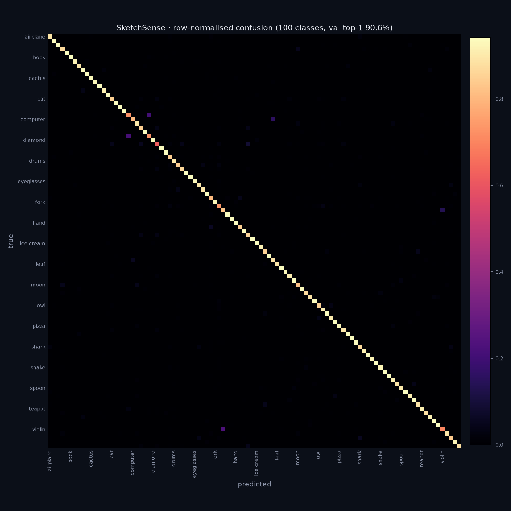

# Evaluation

Model: `100` classes, 1.59 M parameters, best epoch 11.
Held-out split: **72,000 sketches** (6% per class, seed 1337), never used for gradients.

* **Top-1 accuracy: 90.57%**
* Top-5 accuracy: 97.43%

## Most confused pairs

| true | predicted as | count |
|---|---|---|
| violin | guitar | 166 |
| cup | coffee cup | 154 |
| coffee cup | cup | 149 |
| computer | laptop | 115 |
| guitar | violin | 100 |
| dog | horse | 65 |
| hat | flying saucer | 43 |
| laptop | computer | 42 |
| whale | shark | 40 |
| dog | cow | 39 |

## Weakest classes

| class | accuracy | support |
|---|---|---|
| dog | 62.2% | 720 |
| violin | 70.4% | 720 |
| coffee cup | 72.2% | 720 |
| cup | 73.2% | 720 |
| frog | 73.8% | 720 |
| computer | 80.4% | 720 |
| flying saucer | 80.7% | 720 |
| moon | 82.2% | 720 |
| guitar | 83.1% | 720 |
| whale | 83.9% | 720 |
| duck | 84.3% | 720 |
| dragon | 84.6% | 720 |

## Strongest classes

| class | accuracy | support |
|---|---|---|
| bicycle | 98.1% | 720 |
| house | 97.8% | 720 |
| camera | 97.2% | 720 |
| ladder | 97.1% | 720 |
| envelope | 96.7% | 720 |
| skateboard | 96.5% | 720 |
| sailboat | 96.5% | 720 |
| rainbow | 96.5% | 720 |
| pineapple | 96.5% | 720 |
| umbrella | 96.2% | 720 |
| door | 96.2% | 720 |
| butterfly | 96.2% | 720 |

The weak end is almost entirely shape-similar pairs (small round things, long thin things, animal faces). That is the expected failure mode at 64x64 greyscale and it is why the speed round requires 35% confidence rather than a bare argmax.